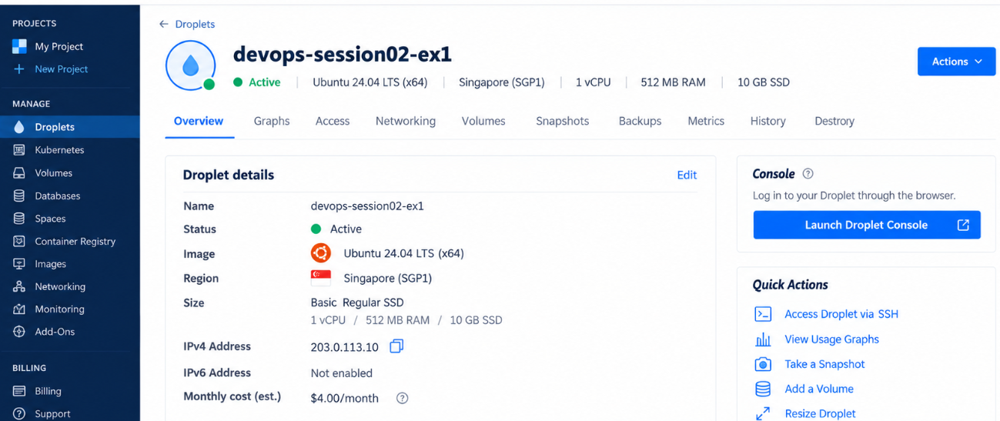
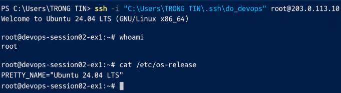

# Khởi tạo Droplet trên DigitalOcean

## 1. Mục tiêu

Bài thực hành này mô tả quá trình tạo một máy chủ thử nghiệm trên DigitalOcean để chuẩn bị chạy các dự án Web. Droplet được cấu hình chạy Ubuntu Server, sử dụng SSH Key để xác thực an toàn thay vì đăng nhập bằng mật khẩu.

## 2. Thông tin cấu hình Droplet

| Tiêu chí | Cấu hình đã chọn |
| --- | --- |
| Cloud Provider | DigitalOcean |
| Loại máy chủ | Droplet |
| Hệ điều hành | Ubuntu 22.04 LTS hoặc Ubuntu LTS mới nhất |
| Plan | Basic |
| Storage | Regular SSD |
| CPU | Shared CPU |
| Gói chi phí | Gói thấp nhất, ví dụ $4/tháng hoặc $6/tháng |
| Region | Singapore |
| Authentication | SSH Keys |
| User đăng nhập | root |

## 3. Tạo SSH Key trên máy cá nhân

Mở Terminal/Git Bash/PowerShell trên máy cá nhân và chạy lệnh:

```bash
ssh-keygen -t ed25519 -C "your_email@example.com"
```

Khi được hỏi vị trí lưu key, có thể nhấn `Enter` để dùng đường dẫn mặc định:

```bash
~/.ssh/id_ed25519
```

Sau khi tạo xong, hệ thống sinh ra 2 file:

```bash
~/.ssh/id_ed25519
~/.ssh/id_ed25519.pub
```

Trong đó:

- `id_ed25519` là private key, cần giữ bí mật.
- `id_ed25519.pub` là public key, dùng để thêm vào DigitalOcean.

Xem nội dung public key:

```bash
cat ~/.ssh/id_ed25519.pub
```

Copy toàn bộ nội dung public key để thêm vào DigitalOcean.

## 4. Thêm SSH Key vào DigitalOcean

Các bước thực hiện:

1. Đăng nhập vào DigitalOcean Console.
2. Vào mục `Settings` hoặc `Security`.
3. Chọn `SSH Keys`.
4. Chọn `Add SSH Key`.
5. Dán nội dung public key từ file `~/.ssh/id_ed25519.pub`.
6. Đặt tên cho key, ví dụ: `personal-laptop-key`.
7. Nhấn `Add SSH Key` để lưu.

## 5. Tạo Droplet Ubuntu

Các bước tạo Droplet:

1. Trong DigitalOcean Console, chọn `Create` -> `Droplets`.
2. Tại mục Image, chọn `Ubuntu 22.04 LTS` hoặc bản Ubuntu LTS mới nhất.
3. Tại mục Region, chọn `Singapore`.
4. Tại mục Droplet Type, chọn `Basic`.
5. Chọn `Regular SSD`.
6. Chọn CPU `Shared`.
7. Chọn gói rẻ nhất, ví dụ `$4/month` hoặc `$6/month`.
8. Tại mục Authentication, chọn `SSH Key`.
9. Chọn SSH Key đã thêm ở bước trước.
10. Đặt hostname cho Droplet, ví dụ: `devops-test-server`.
11. Nhấn `Create Droplet`.

Sau khi tạo thành công, DigitalOcean cấp một địa chỉ IPv4 public cho Droplet.

Ví dụ:

```text
IP_ADDRESS_DROPLET=your_droplet_ip
```

## 6. Kết nối SSH vào Droplet

Từ máy cá nhân, chạy lệnh:

```bash
ssh -i ~/.ssh/id_ed25519 root@<IP_ADDRESS_DROPLET>
```

Ví dụ:

```bash
ssh -i ~/.ssh/id_ed25519 root@your_droplet_ip
```

Ở lần kết nối đầu tiên, terminal có thể hỏi xác nhận fingerprint:

```text
Are you sure you want to continue connecting (yes/no/[fingerprint])?
```

Nhập:

```text
yes
```

Nếu cấu hình đúng, hệ thống sẽ đăng nhập thành công vào Ubuntu Server bằng user `root` mà không cần nhập mật khẩu.

## 7. Log kết nối thành công

Dán log kết nối thành công vào phần bên dưới:

```text
$ ssh -i ~/.ssh/id_ed25519 root@<IP_ADDRESS_DROPLET>
Welcome to Ubuntu 22.04 LTS (GNU/Linux ...)

...

root@devops-test-server:~#
```

## 8. Ảnh minh chứng

Thêm ảnh chụp màn hình DigitalOcean Console hoặc Terminal vào thư mục này, sau đó cập nhật đường dẫn ảnh bên dưới.



## 9. Kết quả

Droplet Ubuntu đã được khởi tạo trên DigitalOcean với cấu hình tiết kiệm chi phí. Máy chủ sử dụng xác thực bằng SSH Key và có thể đăng nhập thành công từ máy cá nhân bằng tài khoản mặc định `root`.
